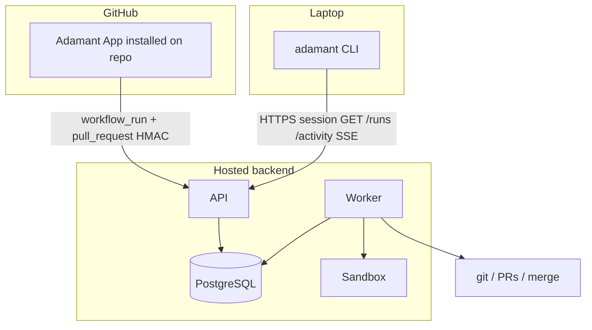
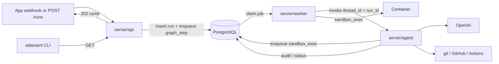
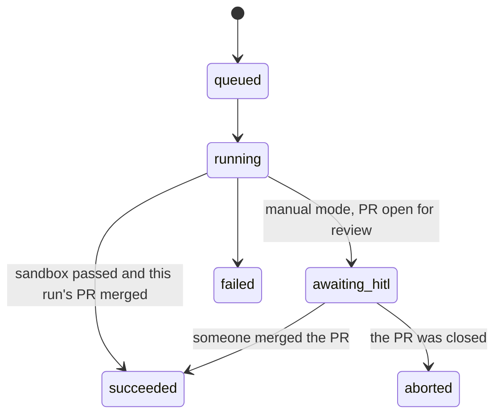
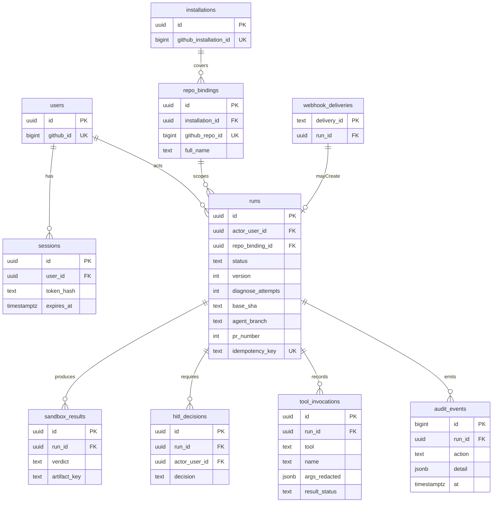

# Architecture

Adamant repairs a repo on a working branch, proves the change in a sealed
container, opens a pull request, and **merges that PR**. It does not wait
for a human.

The product is a hosted backend plus a CLI that stays connected to it.
Work list: [tasks.md](tasks.md). Tables: [database.md](database.md).



The API authenticates and ACKs. It does **not** run models or Docker. Workers
**import** `server/agent`. There is no `/agent` HTTP route.

## Now vs later

| Now                                                                       | Later                                                       |
| ------------------------------------------------------------------------- | ----------------------------------------------------------- |
| Hosted App + worker, CLI attached to that API, sandbox, merge our heal PR | Electron Heal, OAuth, HITL, agent-on-checkout, fingerprints |

Auth today: webhook HMAC for GitHub, and a session for the CLI and
`POST /runs`, from `/login` (GitHub OAuth, below). For scripts,
`pnpm --filter @adamant/server session:create` adds a `sessions` row and
prints its token once.

## Two surfaces

### GitHub App (plugin)

Installed on the eval repo. The **hosted** API and worker stay up. GitHub
sends webhooks to that origin. We do **not** poll. Compose on a laptop is
only for developing the backend.

| Event                             | We do                                                                                                     |
| --------------------------------- | --------------------------------------------------------------------------------------------------------- |
| `workflow_run` failed             | On the default branch of the bound repo only: insert `queued` run, enqueue `graph_step`                   |
| `pull_request` closed + merged    | If `pr_number` matches a run → `merged`. Else keep the delivery (`run_id` null) for the CLI               |
| `ping` / `installation`           | Store delivery; upsert `installations` / `repo_bindings`                                                  |
| `installation_repositories` added | Store the delivery; upsert the installation and the added repositories. No heal. `removed` is not applied |

A merge never starts a heal. Red CI does.

Webhook URL: `https://<hosted>/webhooks/github`. Smee or ngrok only when
the API is not hosted yet.

### CLI

The `adamant` terminal (`tui/`) on the laptop, **always pointed at the hosted API**
(`ADAMANT_API_URL` + `ADAMANT_SESSION`). It follows the feed from launch
(SSE, reconnect on drop; history from before launch is skipped) and its own
coding agent works on the local checkout. Closing the CLI does not stop heals.

The graph writes `run.retrieved`, `run.sandboxed` (each attempt's verdict),
`run.pr_opened` and `run.merged` to `audit_events`, and the webhook's
`run.queued` names the repository, so the feed shows every step of a heal.

| Command                          | Hosted API                                                          |
| -------------------------------- | ------------------------------------------------------------------- |
| `adamant status`                 | `GET /health`                                                       |
| `adamant runs`                   | `GET /runs`                                                         |
| `adamant run <id>`               | `GET /runs/:id` (status + `audit_events`)                           |
| `adamant watch`                  | `GET /activity` SSE                                                 |
| `adamant install <owner>/<repo>` | `GET /github/install`, then poll `GET /github/installations/status` |

`install` prints `https://github.com/apps/<GITHUB_APP_SLUG>/installations/new`
and waits until that exact owner and name is a `repositories` row. The CLI
does not hold the slug, a private key, or an installation token. Without
Postgres the API says install confirmation needs the hosted API; it does not
read the in-memory schema maps.

No GitHub token and no merge from the CLI. Its agent calls the model with
the user's own key, which never reaches the API, the worker or a command the
agent runs, and it can start a heal only through `POST /runs` like any session.
The repository picker reads the user's repositories with their local `gh`
login; that token stays inside `gh`. Until the API is hosted, the CLI defaults
to `http://localhost:8787`; switch the default to the hosted origin once it
exists.

## Identity

Two principals. Do not mix their tokens.

| Principal               | Authenticates how                   | Purpose                               |
| ----------------------- | ----------------------------------- | ------------------------------------- |
| User                    | Session from GitHub or Google OAuth | CLI + `POST /runs`                    |
| GitHub App installation | HMAC + per-call installation token  | What the agent may do on a bound repo |

Installation tokens are minted per call. They are never stored in the CLI,
Electron, sessions, checkpoints, prompts, or the sandbox.

The worker sees `{ runId }` only. It trusts a `runs` row the API already
created.

## Auth

| Route                               | Auth                  | Does                                            |
| ----------------------------------- | --------------------- | ----------------------------------------------- |
| GitHub webhook                      | `X-Hub-Signature-256` | Insert `webhook_deliveries`; maybe create a run |
| `POST /runs`                        | Session               | Start a run                                     |
| `GET /runs`                         | Session               | CLI list                                        |
| `GET /runs/:id`                     | Session               | CLI detail                                      |
| `GET /activity`                     | Session               | CLI watch (deliveries + audit, newest first)    |
| `GET /github/install`               | Session               | Public install URL from `GITHUB_APP_SLUG`       |
| `GET /github/installations/status`  | Session               | Exact `repositories` owner and name, or 404     |
| `GET /auth/{github,google}`         | None, rate-limited    | Browser sign-in: state + PKCE, redirect         |
| `POST /auth/github/cli/start`       | None, rate-limited    | Start a terminal sign-in (below)                |
| `GET /auth/github/cli/begin`        | None, rate-limited    | The terminal's browser link to GitHub           |
| `GET/POST /auth/github/cli/confirm` | Confirmation cookie   | Show the code; confirm or cancel                |
| `POST /auth/github/cli/token`       | Poll secret           | 202 until confirmed, then the token once        |

A session is a random token sent as `Authorization: Bearer` (or the
`adamant_session` cookie for a browser); Postgres keeps its SHA-256 only. A
session lookup that cannot reach Postgres answers 503 "The database is
unavailable", not 401 or 500, so a client retries instead of signing out.

### Sign-in

Every authorize redirect carries a fresh `state` (also an HttpOnly cookie
scoped to the callback) and a PKCE S256 challenge. The verifier is a new
column on that `oauth_states` row; the callback deletes the row (one use, 15
minutes) and sends the verifier only in the token exchange body, never in a
URL or a log. GitHub is asked for `user:email` only: `/user` gives the
numeric id and login, `/user/emails` the verified primary address. No
provider token is kept.

The terminal signs in through the browser, device-flow style:

1. `POST /auth/github/cli/start` returns a login id, a poll secret and a
   code (`XXXX-XXXX`, RFC 8628's no-vowel alphabet). The terminal prints
   "Confirm the code XXXX-XXXX in your browser" and opens `beginPath`.
2. `begin` makes the OAuth state and binds it to the login (opening the
   link again rebinds it). After GitHub, the callback names the user but
   mints no session: it sets an HttpOnly `adamant_cli_confirm` cookie and
   redirects to `/auth/github/cli/confirm`.
3. That page shows the code with "This is the code in my terminal" and
   "Cancel". It runs no script, cannot be framed (`frame-ancestors 'none'`,
   `X-Frame-Options: DENY`), escapes what it renders, and never holds the
   poll secret, the cookie or a token. Its POST must carry the cookie
   (SameSite=Lax) and a form token derived from it, and must not be
   cross-site (`Sec-Fetch-Site`).
4. The terminal polls `POST /auth/github/cli/token`. Only after the
   confirmation does one poll get a token, minted then; a cancel, a decline
   at GitHub or a failed callback answers 403, an unknown or expired login 404.

So a sign-in link sent to someone else shows them a code that matches no
terminal of theirs, and nothing reaches the sender's terminal unless they
confirm it anyway.

Logins live in `cli_logins` (`server/db/schema/cliLogins.ts`), so a restart
(`node --watch`) or another instance can answer any step: status
`pending` → `authorized` → `confirmed` → `consumed`, or `cancelled`, the user
id once GitHub has named one, and SHA-256 hashes of the login id, the poll secret,
the bound OAuth state and the confirmation cookie. "Issued once" is the
poll's `UPDATE … WHERE status = 'confirmed' RETURNING user_id`. Expired rows
go with expired OAuth states in the worker's hourly `cleanup_oauth_states`.
Tests use the in-memory store behind the same interface.

The unauthenticated routes that write a row (`/auth/{github,google}`,
`cli/start`, `cli/begin`) share a token bucket per client address (IPv6 by
/64): 20 at once, 20 a minute. It lives in each API process, so N instances
allow N times that, and it reads the TCP peer, not `X-Forwarded-For`;
behind a proxy every client shares the proxy's bucket, so limit at the
proxy too.

Webhook: known `installation_id`, bind the repo, insert
`webhook_deliveries` **before** the run. Duplicate `delivery_id` → ACK, no
second run. Failed `workflow_run` → `queued` run + enqueue `graph_step`.
Use the seed user as `actor_user_id` until OAuth exists.

Only a failure whose `head_branch` is the repo's default branch and whose
`head_repository` is the bound repo starts a heal. The heal PR is built on
`head_sha` and merged into the default branch, so a fork PR, a feature
branch, or an `adamant/*` PR would merge someone else's commits with the fix
(or heal itself in a loop). One heal per commit: each failing workflow sends
its own delivery, and the heal already reads every failed job at that SHA.

HITL (`POST /runs/:id/hitl`) is later. The heal merges without it.

When you add Electron login later: PKCE in main (its own, for a public
client), session secret in `safeStorage`, Postgres stores
`sessions.token_hash` only, renderer never sees the secret. Then `POST /runs` also checks collaborator access (401 /
403 / 404).

## Workers

`graphile-worker` is the queue (no `jobs` table). The API inserts `runs`
(`queued`) and enqueues a task. The worker claims it and runs the graph
in-process.

| Task           | Process        | Does                                                   |
| -------------- | -------------- | ------------------------------------------------------ |
| `graph_step`   | Graph worker   | `import` `server/agent` and `invoke` the LangGraph     |
| `sandbox_exec` | Sandbox worker | Start the container; write `sandbox_results`; no model |

`server/agent` has no `listen()` and must not import Hono.



```ts
import { compileOpenAiHealGraph } from '../agent/index.ts'

await compileOpenAiHealGraph({ git, sandbox, recorder }, { checkpointer }).invoke(
  { runId, repository, baseSha },
  { configurable: { thread_id: runId } },
)
```

`thread_id = run_id`. `OPENAI_API_KEY` lives in the worker environment, never
on `runs`, in checkpoints, in the CLI, or in Electron.

The graph does not `interrupt()` for a human. After a passing sandbox the
graph opens the PR and merges it. HITL `interrupt()` is later.

Worker death: lock TTL; resume the checkpoint. Do not start a second graph
for the same run.

## Agent tools

LangGraph calls **tools**, not raw `child_process` from the model. Every
call is allowlisted, logged on `audit_events`, and attributed to `run_id`.
Unknown commands fail closed.

### git (graph worker)

Per-run worktree. Credentials through a one-shot `GIT_ASKPASS`, then discarded.

Allowed: `fetch`, `checkout`, `switch -c`, `status`, `diff`, `log`, `show`,
`rev-parse`, `add`, `commit`, `push` (agent branch only).

`git_read_file` reads a file from the run's worktree so the model sees the
code a failure points at. Read-only, confined to the worktree (no `..`, no
`.git`, no symlink out), bounded, and logged with its path but not its
contents. The commit holds only what `apply --index` staged, never files the
sandbox wrote.

Denied: push to the default branch, `push --force`, `reset --hard` of
protected refs, rebase onto default, credential helpers, untrusted
submodules.

The adapter sets the push refspec (`refs/heads/adamant/{run_id}`). The model
does not.

### GitHub API

Contents, compare, commits, issues, pull requests, review comments, check
runs, and **`merge_pull_request`** for this run only.

`merge_pull_request` is allowed only when all of these hold:

- latest `sandbox_results.verdict` is `pass`, read back from the table, not
  from graph state
- the run's `pr_publications` row is set and matches the PR being merged
- the PR head is `refs/heads/adamant/{run_id}` on the bound repo
- squash merge (or the repo's one allowed method) — not a merge of some
  other branch

Denied: merging any other PR, delete default branch, admin/ruleset edits,
token minting, anything outside the bound `repo_id`. The model does not
pick the PR number; the adapter reads it from the run.

### GitHub Actions

Read and wait. Do not treat Actions as the sandbox.

| Tool                             | Use                                         |
| -------------------------------- | ------------------------------------------- |
| `list_workflow_runs`             | CI on the agent branch / PR                 |
| `get_workflow_run` / jobs / logs | Diagnose a red build                        |
| `rerun_failed_jobs`              | After a patch (later; the heal can skip it) |
| `workflow_dispatch`              | Only workflows tagged `adamant-allowed`     |

### git in the sandbox

Detached worktree, remotes and credentials stripped. May `diff` / `log`.
Cannot `push`, `fetch`, or see `GIT_ASKPASS`.

### Heal agents (OpenAI Agents SDK)

With `ADAMANT_HEAL_AGENT=agents` (the default; `classic` opts out) the
diagnose, plan and patch steps are Agents SDK agents
(`server/agent/autonomous.ts`) instead of one model call each. They call
four tools, nothing else; `ALLOWED_AGENT_TOOLS` is the list:

| Tool         | Goes through                          | Logged as                              |
| ------------ | ------------------------------------- | -------------------------------------- |
| `list_files` | gateway → `git ls-files`              | `git_list_files`                       |
| `read_file`  | gateway → worktree read (confined)    | `git_read_file` (path, not contents)   |
| `search`     | gateway → `git grep --fixed-strings`  | `git_search` (the text, not matches)   |
| `try_patch`  | gateway apply → sandbox → `git_reset` | `git_apply_patch`, `sandbox_try_patch` |

`try_patch` applies a candidate to the clean base, runs the sandbox, and
resets, at most three times per candidate; each try is an
`run.agent_tried` audit event. A try is evidence for the model only: the
graph applies the diff the fixer returns, runs the sandbox itself, writes
`sandbox_results`, and the push / PR / merge gates read that row as before.
Tool output is redacted and bounded. Tracing to OpenAI is off. A broken
investigator run falls back to the one-shot provider; a fixer that runs out
of turns spends the attempt.

### Finding work without webhooks

GitHub does not redeliver a delivery that failed or went to the wrong URL.
The worker's `sync_github` task (every minute, at boot, and when the CLI is
waiting on an install) reads the App's installations and repositories,
binds them, and queues a heal when a default branch's newest commit has a
failed workflow, with the webhook's idempotency key
(`workflow_run:{sha}`), so the two paths never heal one commit twice. It
also settles runs left for review (below). `server/worker/doctor.ts` reads
the App's webhook settings at boot and from `scripts/adamant` and says when
the App sends to a channel this machine does not forward, or has no secret.

### Merge mode

The terminal's approval mode is saved on the user (`users.auto_merge`,
`PUT /settings`). Just before the merge the worker reads the mode of the
run's creator, else of the user signed in with the GitHub account that
owns the repository (`github_installations.account_github_id`), else
merges. Manual leaves the PR open: the run ends `awaiting_hitl` with a
`run.awaiting_review` event, and the sync marks it `succeeded` when someone
merges the PR or `aborted` when it is closed.

### Sandbox profile

The sandbox commands come from the checkout: a repository with a
`package.json` uses `ADAMANT_SANDBOX_*`; one with Python packaging runs in
`python:<CI version>-slim` with a venv in the worktree
(`.adamant-venv`, excluded from the run's git) and `pytest`.
`ADAMANT_SANDBOX_PROFILE=fixed` turns detection off.

## Run state



`runs.status` is coarse: `queued`, `running`, then `succeeded` or `failed`.
The graph checkpoint holds which node is executing. A merged `pull_request`
webhook may confirm `succeeded` for our PR; it must not merge a second time.

`awaiting_hitl` stays in the check constraint for later. A merge without a
passing `sandbox_results` row is rejected. Push and open-PR are rejected the
same way.

## Graph

Commit locally. Sandbox. Push the agent branch **once**, after a pass, open
the PR, merge it.

```mermaid
flowchart TD
  retrieve[Clone and inspect] --> diagnose[Diagnose including Actions logs]
  diagnose --> plan[Plan]
  plan --> patch[Commit locally]
  patch --> sandbox[Sandbox]
  sandbox --> diagnose: fail retries left
  sandbox --> openPr[Push adamant/run_id and open PR]
  openPr --> mergePr[Merge that PR]
```

`diagnose_attempts` is capped on the run.

## Data

Enums, columns, migrations: [database.md](database.md). There is no `jobs`
table.



- Queue: graphile-worker (`graph_step` / `sandbox_exec`, payload `{ runId }`)
- Checkpoints: LangGraph library tables, `thread_id = run_id`
- `runs.idempotency_key`: `workflow_run:{head_sha}` or client `Idempotency-Key`
- Redact tool args before persist (no tokens)

## Heal path

```mermaid
sequenceDiagram
  participant Gh as GitHub
  participant Api as API
  participant Pg as Postgres
  participant Graph as Graph worker
  participant Box as Sandbox

  Gh ->> Api: workflow_run failed HMAC
  Api ->> Pg: delivery + queued run + job
  Api -->> Gh: 202
  Graph ->> Pg: claim
  Graph ->> Gh: checkout SHA, fetch logs
  Graph ->> Graph: commit locally
  Graph ->> Box: sandbox_exec
  Box -->> Pg: verdict
  Graph ->> Gh: push adamant/run_id, open PR, merge it
  Gh ->> Api: pull_request merged HMAC
  Api ->> Pg: run merged + activity
```

`POST /runs` is the same after the 202. `adamant watch` reads `/activity`.

## Sandbox

Host clones, strips remotes and credentials, then starts the container.

- network off during tests (registry allowlist only for install)
- no `docker.sock`, dropped caps, memory / CPU / PID / time limits
- one container per job, destroyed on exit
- logs go to the artifact store; `verdict` is `pass` or `fail`

## Failure

| Case                       | What happens                                   |
| -------------------------- | ---------------------------------------------- |
| Duplicate webhook          | `delivery_id` PK, ACK, no second run           |
| Worker death               | lock TTL; resume checkpoint                    |
| git / API 403              | fail the run; do not retry from the sandbox    |
| Actions timeout            | treat as fail evidence; sandbox still required |
| Merge without sandbox pass | denied; run stays unmerged                     |
| Merge of a different PR    | denied; fail the run                           |
| Merged PR we did not open  | Store delivery; CLI shows it; no heal          |
| Bad webhook HMAC           | 401; no `webhook_deliveries` row               |
| No / expired session       | 401 on `POST /runs`                            |
| Session ok, no repo access | 403 (when OAuth exists)                        |

## Later

HITL before merge, Electron Heal, OAuth, agent-on-checkout, fingerprints,
`/adamant approve`.

## Ruleset

[`adamant-protocols.json`](../adamant-protocols.json) is the desired live ruleset. It targets
`~DEFAULT_BRANCH` and requires CodeRabbit's native status so a pull request cannot merge while its
review is still processing. Repository administrators keep the GitHub ruleset aligned with this
file.
